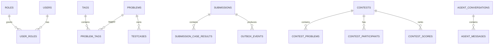

# 数据库设计文档（Database Design）

## 1. 设计原则

本项目使用 MySQL 作为核心业务数据的 Source of Truth。

核心原则：

1. **Data Ownership**：每个 Service 只能直接访问自己拥有的 Schema / Table。
2. **Logical Database per Service**：本地可以只运行一个 MySQL 实例，但逻辑上按服务隔离。
3. Redis 是 Cache / Realtime View，不替代核心持久化事实。
4. 测试数据、源码产物、编译日志和 RAG 原始文档优先存 MinIO。
5. 所有 Schema Change 通过 Migration 管理。
6. DB State Change + MQ Event 需要可靠一致性时使用 Transactional Outbox。
7. 跨服务关联通过 ID、gRPC 或 Event，不使用跨服务 SQL Join。

v0 建议逻辑 Schema：

```text
oj_user
oj_problem
oj_submission
oj_contest
oj_agent
```

这些 Schema 可以部署在同一个 MySQL Container 中，但所有权保持独立。

---

## 2. 数据所有权

| Schema | Owner | Core Data |
| --- | --- | --- |
| `oj_user` | user-service | User、Role |
| `oj_problem` | problem-service | Problem、Tag、Testcase Metadata |
| `oj_submission` | judge-service | Submission、Case Result、Outbox、Dedup |
| `oj_contest` | contest-service | Contest、Participant、Leaderboard Snapshot |
| `oj_agent` | agent-service | Conversation、Message、Run |

禁止：

```text
contest-service
  ↓ SQL JOIN
oj_submission.submissions
```

正确：

```text
contest-service
  ↓ gRPC / RabbitMQ Event
judge-service
```

Agent 也不允许读取其他业务 Schema。

---

## 3. ER 总览



注意：图中关系描述逻辑关系；不同 Service Schema 之间不建立跨库外键。

---

# 4. `oj_user`

## 4.1 `users`

职责：用户账户与认证主体。

| Column | Type | Constraint / Note |
| --- | --- | --- |
| `id` | BIGINT | PK |
| `username` | VARCHAR(64) | UNIQUE, NOT NULL |
| `email` | VARCHAR(255) | UNIQUE, NOT NULL |
| `password_hash` | VARCHAR(255) | NOT NULL |
| `status` | VARCHAR(32) | NOT NULL |
| `created_at` | DATETIME(3) | NOT NULL |
| `updated_at` | DATETIME(3) | NOT NULL |

建议索引：

```text
UNIQUE(username)
UNIQUE(email)
INDEX(status, created_at)
```

密码只保存安全 Hash，不保存明文密码。

## 4.2 `roles`

| Column | Type | Note |
| --- | --- | --- |
| `id` | BIGINT | PK |
| `name` | VARCHAR(64) | UNIQUE |
| `description` | VARCHAR(255) | Optional |

初始角色可以包括：

```text
user
problem_admin
system_admin
```

## 4.3 `user_roles`

| Column | Type | Note |
| --- | --- | --- |
| `user_id` | BIGINT | FK within `oj_user` |
| `role_id` | BIGINT | FK within `oj_user` |
| `created_at` | DATETIME(3) | NOT NULL |

约束：

```text
PRIMARY KEY(user_id, role_id)
```

Refresh Token 元数据优先放 Redis；如果后续需要长期审计，再新增持久化 Session 表。

---

# 5. `oj_problem`

## 5.1 `problems`

| Column | Type | Note |
| --- | --- | --- |
| `id` | BIGINT | PK |
| `title` | VARCHAR(255) | NOT NULL |
| `slug` | VARCHAR(255) | UNIQUE |
| `description` | TEXT | NOT NULL |
| `difficulty` | VARCHAR(32) | NOT NULL |
| `time_limit_ms` | INT | NOT NULL |
| `memory_limit_kb` | INT | NOT NULL |
| `active_judge_revision` | CHAR(26) | Nullable, published immutable testcase revision |
| `status` | VARCHAR(32) | normal / archived |
| `created_by` | BIGINT | User ID reference only; no cross-DB FK |
| `created_at` | DATETIME(3) | NOT NULL |
| `updated_at` | DATETIME(3) | NOT NULL |

建议索引：

```text
UNIQUE(slug)
INDEX(status, difficulty, id)
INDEX(created_by, created_at)
```

## 5.2 `tags`

| Column | Type | Note |
| --- | --- | --- |
| `id` | BIGINT | PK |
| `name` | VARCHAR(64) | UNIQUE |
| `created_at` | DATETIME(3) | NOT NULL |

## 5.3 `problem_tags`

| Column | Type | Note |
| --- | --- | --- |
| `problem_id` | BIGINT | FK within `oj_problem` |
| `tag_id` | BIGINT | FK within `oj_problem` |

约束：

```text
PRIMARY KEY(problem_id, tag_id)
```

## 5.4 `testcases`

测试数据正文存 MinIO，本表只保存 Metadata。

| Column | Type | Note |
| --- | --- | --- |
| `id` | BIGINT | PK |
| `problem_id` | BIGINT | FK |
| `case_no` | INT | NOT NULL |
| `input_object_key` | VARCHAR(512) | MinIO key |
| `output_object_key` | VARCHAR(512) | MinIO key |
| `input_sha256` | CHAR(64) | NOT NULL |
| `output_sha256` | CHAR(64) | NOT NULL |
| `input_size_bytes` | BIGINT | Input object size |
| `output_size_bytes` | BIGINT | Output object size |
| `status` | VARCHAR(32) | active / archived |
| `created_at` | DATETIME(3) | NOT NULL |
| `archived_at` | DATETIME(3) | Nullable archive time |
| `updated_at` | DATETIME(3) | NOT NULL |

约束：

```text
UNIQUE(problem_id, case_no)
INDEX(problem_id, status, case_no)
```

保留 hash 以支持对象完整性校验。测试用例删除使用 `status=archived`
标记。`testcases` 只表示管理员当前编辑视图，不增加 `version` 字段。

每次发布测试集时生成新的 ULID `judge_revision`，把全部有效测试点写入
MinIO `problem-data` bucket 的不可变前缀：

```text
problem-{problem_id}/judge-revisions/{judge_revision}/manifest.json
problem-{problem_id}/judge-revisions/{judge_revision}/testcases/{case_no}.in
problem-{problem_id}/judge-revisions/{judge_revision}/testcases/{case_no}.out
```

`manifest.json` 固化 case 顺序、对象 key、大小和 SHA-256。所有对象上传并
校验成功后，Problem Service 才在提交测试用例最新状态的同一个 MySQL 事务中
切换 `problems.active_judge_revision`。revision 历史和 manifest 仅保存在 MinIO，
MySQL 不保存 revision 历史表。失败的未发布前缀由后台 GC 清理；
首版所有已发布 revision 均不可覆盖、不可物理删除。未来若需要回收，必须
通过显式事件或内部 API 建立引用与保留期，禁止 Problem Service 跨库查询
Judge Service 的 Submission 引用。

归档最后一个有效测试点时不发布空 revision；MySQL 将
`active_judge_revision` 置为 `NULL`，旧 MinIO revision 继续保留给历史 Submission。

---

# 6. `oj_submission`

## 6.1 `submissions`

| Column | Type | Note |
| --- | --- | --- |
| `id` | BIGINT | PK |
| `user_id` | BIGINT | User ID reference, no cross-DB FK |
| `problem_id` | BIGINT | Problem ID reference, no cross-DB FK |
| `contest_id` | BIGINT | Nullable contest ID; NULL means ordinary submission |
| `language` | VARCHAR(32) | c / cpp / go / python / java |
| `source_object_key` | VARCHAR(512) | Immutable MinIO key |
| `source_sha256` | CHAR(64) | NOT NULL |
| `source_size_bytes` | BIGINT | NOT NULL |
| `judge_revision` | CHAR(26) | Immutable testcase revision |
| `status` | VARCHAR(32) | QUEUED / COMPILING / RUNNING / RETRY_WAIT / DONE / CANCELLED / INVALIDATED |
| `verdict` | VARCHAR(32) | AC / WA / TLE / MLE / RE / CE / SYSTEM_ERROR |
| `time_ms` | INT | Nullable |
| `memory_kb` | INT | Nullable |
| `retry_count` | INT | Infrastructure retry count, default 0 |
| `system_error_reason` | VARCHAR(128) | Nullable stable reason code |
| `judge_deadline_at` | DATETIME(3) | Overall execution deadline |
| `created_at` | DATETIME(3) | NOT NULL |
| `judged_at` | DATETIME(3) | Nullable |
| `invalidated_at` | DATETIME(3) | Nullable admin rejudge invalidation time |
| `updated_at` | DATETIME(3) | NOT NULL |

建议索引：

```text
INDEX(user_id, created_at, id)
INDEX(problem_id, created_at, id)
INDEX(status, created_at)
INDEX(verdict, created_at)
```

一个 Submission 就是一次逻辑判题。状态更新必须使用条件更新，防止重复或
迟到 Event 造成非法回退；`INVALIDATED` 是终态，即使 Worker 随后返回结果也
不得恢复。基础设施重试复用同一个 ID，`retry_count` 最多为 3。

源码正文存入 MinIO `submission-source` bucket，使用随机 ULID 生成不可变 key，
例如 `sources/{source_id}/source.cpp`。上传成功后再在 Submission + Outbox
事务中记录 key、hash 和大小；事务失败产生的未引用对象由后台 GC
按安全保留期清理。源码对象不覆盖，重判复用同一源码对象。

管理员重判必须在同一事务中把旧 Submission 标记为 `INVALIDATED`，写入
`submission.invalidated` Outbox，并为原 `user_id` 创建使用当前
`judge_revision` 的新 Submission 与 `judge.requested` Outbox。旧 Verdict 可以
保留用于审计，但业务和 Contest 必须以 `INVALIDATED` 状态判定其结果无效。
不保存 parent/root/origin 关系。

## 6.2 `submission_case_results`

| Column | Type | Note |
| --- | --- | --- |
| `id` | BIGINT | PK |
| `submission_id` | BIGINT | FK within `oj_submission` |
| `case_no` | INT | NOT NULL |
| `verdict` | VARCHAR(32) | NOT NULL |
| `time_ms` | INT | Nullable |
| `memory_kb` | INT | Nullable |
| `message` | VARCHAR(1024) | Optional |
| `created_at` | DATETIME(3) | NOT NULL |

约束：

```text
UNIQUE(submission_id, case_no)
INDEX(submission_id)
```

## 6.3 `outbox_events`

用于 Transactional Outbox。

| Column | Type | Note |
| --- | --- | --- |
| `id` | BIGINT | PK |
| `event_id` | CHAR(36) | UNIQUE |
| `aggregate_type` | VARCHAR(64) | submission |
| `aggregate_id` | BIGINT | submission_id |
| `event_type` | VARCHAR(128) | Internal intent, e.g. judge.requested |
| `event_version` | INT | NOT NULL |
| `payload` | JSON | Event Payload |
| `status` | VARCHAR(32) | pending / published / dead |
| `retry_count` | INT | default 0 |
| `next_retry_at` | DATETIME(3) | Nullable |
| `lease_owner` | VARCHAR(128) | Nullable relay instance |
| `lease_until` | DATETIME(3) | Nullable |
| `last_error` | VARCHAR(255) | Last stable publish failure reason |
| `created_at` | DATETIME(3) | NOT NULL |
| `published_at` | DATETIME(3) | Nullable |

建议索引：

```text
UNIQUE(event_id)
INDEX(status, next_retry_at, id)
INDEX(aggregate_type, aggregate_id)
```

Relay 使用短事务和 `SELECT ... FOR UPDATE SKIP LOCKED` 领取未发布事件并设置
lease；发布成功并收到 Publisher Confirm 后标记 `published`。临时失败按退避策略
回到 `pending`，超过最大次数后进入 `dead` 并保留 `last_error`。lease 只能降低
并发碰撞，不能替代 Consumer 幂等。

## 6.4 `processed_events`

用于 Consumer 幂等去重的一种实现。

| Column | Type | Note |
| --- | --- | --- |
| `consumer_name` | VARCHAR(128) | Consumer identifier |
| `event_id` | CHAR(36) | Event ID |
| `processed_at` | DATETIME(3) | NOT NULL |

约束：

```text
PRIMARY KEY(consumer_name, event_id)
```

也可以使用业务唯一约束完成幂等；具体实现按 Consumer 选择。

## 6.5 `idempotency_requests`

用于 Create/Rejudge 写请求的网络重试去重，不表达 Submission 父子关系。

| Column | Type | Note |
| --- | --- | --- |
| `actor_id` | BIGINT | Authenticated caller ID |
| `operation` | VARCHAR(64) | create_submission / rejudge_submission |
| `idempotency_key` | CHAR(36) | Client-generated UUID |
| `request_hash` | CHAR(64) | Reject same key with different payload |
| `response` | JSON | First successful response |
| `created_at` | DATETIME(3) | NOT NULL |
| `expires_at` | DATETIME(3) | NOT NULL |

约束：

```text
PRIMARY KEY(actor_id, operation, idempotency_key)
INDEX(expires_at)
```

---

# 7. `oj_contest`

Contest 为后续阶段。

## 7.1 `contests`

| Column | Type | Note |
| --- | --- | --- |
| `id` | BIGINT | PK |
| `title` | VARCHAR(255) | NOT NULL |
| `status` | VARCHAR(32) | draft / running / ended / archived |
| `start_at` | DATETIME(3) | NOT NULL |
| `end_at` | DATETIME(3) | NOT NULL |
| `created_by` | BIGINT | User ID reference |
| `created_at` | DATETIME(3) | NOT NULL |
| `updated_at` | DATETIME(3) | NOT NULL |

## 7.2 `contest_problems`

| Column | Type | Note |
| --- | --- | --- |
| `contest_id` | BIGINT | FK within `oj_contest` |
| `problem_id` | BIGINT | External Problem ID |
| `sort_order` | INT | NOT NULL |
| `score` | INT | Optional |

约束：

```text
PRIMARY KEY(contest_id, problem_id)
```

## 7.3 `contest_participants`

| Column | Type | Note |
| --- | --- | --- |
| `contest_id` | BIGINT | FK |
| `user_id` | BIGINT | External User ID |
| `joined_at` | DATETIME(3) | NOT NULL |

约束：

```text
PRIMARY KEY(contest_id, user_id)
```

Contest Service 的 `JoinContest` 在比赛开始前向该表幂等插入报名记录。`user_id` 由认证
上下文提供，不能由客户端指定；重复报名返回已有 `joined_at`。

## 7.4 `contest_scores`

最终结果或快照。

| Column | Type | Note |
| --- | --- | --- |
| `contest_id` | BIGINT | FK |
| `user_id` | BIGINT | External User ID |
| `score` | INT | NOT NULL |
| `penalty` | BIGINT | NOT NULL |
| `accepted_count` | INT | NOT NULL |
| `updated_at` | DATETIME(3) | NOT NULL |

约束：

```text
PRIMARY KEY(contest_id, user_id)
INDEX(contest_id, score, penalty)
```

该表为旧设计预留，本版排行榜不读写 `contest_scores`，不使用 Redis ZSET。

## 7.5 Contest 结果投影

迁移：`migrations/contest/000002_create_result_projection.up.sql`。

| Table | Key / Index | 用途 |
| --- | --- | --- |
| `contest_processed_events` | PK `(consumer_name,event_id)` | 事务内消费幂等，UUID 使用 ascii_bin |
| `contest_submission_results` | PK `submission_id`；索引 `(contest_id,user_id,problem_id,submitted_at,submission_id)` | 唯一提交事实、verdict、submitted_at、judged_at、invalidated、updated_at |
| `contest_problem_results` | PK `(contest_id,user_id,problem_id)` | solved、wrong_attempts、accepted_submission_id、accepted_at、penalty_seconds、updated_at |

投影时间使用 DATETIME(6)。归属通过 Contest 本地表校验，外键只引用本地 participants/problems。
事务插入 processed_events 后锁定参与者行（READ COMMITTED），保存最新事实并按 submitted_at/id 重建单题。
同 ID 的 judged_at 必须严格递增；invalidated 为不可恢复作废记录，先到的作废事件也能阻挡迟到结果。
排行榜在只读 REPEATABLE READ 事务中聚合题目结果，保证总数、分页和题目明细一致；
SUM(solved) DESC、SUM(penalty_seconds) ASC、user_id ASC。只统计有本地结果的用户。
罚时用首次 AC submitted_at 减去比赛 start_at，再加 AC 前有效错误次数乘以 1200 秒。

---

# 8. `oj_agent`

Agent 只能在自己的 Schema 保存会话数据，不能保存“绕过业务服务权限”取得的业务镜像。

## 8.1 `agent_conversations`

| Column | Type | Note |
| --- | --- | --- |
| `id` | CHAR(36) | PK |
| `user_id` | BIGINT | Owner ID |
| `title` | VARCHAR(255) | Optional |
| `created_at` | DATETIME(3) | NOT NULL |
| `updated_at` | DATETIME(3) | NOT NULL |

建议索引：

```text
INDEX(user_id, updated_at, id)
```

## 8.2 `agent_messages`

| Column | Type | Note |
| --- | --- | --- |
| `id` | BIGINT | PK |
| `conversation_id` | CHAR(36) | FK within `oj_agent` |
| `run_id` | CHAR(36) | Nullable FK within `oj_agent` |
| `role` | VARCHAR(32) | user / assistant / tool |
| `content` | MEDIUMTEXT | 根据隐私策略保存 |
| `tool_name` | VARCHAR(128) | Nullable |
| `created_at` | DATETIME(3) | NOT NULL |

建议索引：

```text
INDEX(conversation_id, id)
INDEX(run_id)
```

敏感源码、Prompt、Tool Result 是否持久化应由后续隐私策略明确；默认避免无必要长期保存。

PR2 实际保存用户输入和完成后的 assistant 答案，不写入 tool 消息、源码对象或原始模型
Prompt。每条消息上限 32,000 字符，页面消息查询最近最多 200 条并按 ID 升序返回。表结构见
`migrations/agent/000001_create_agent_runtime.up.sql`；应用不运行自动建表。

Issue #162 PR2 的模型历史查询独立于页面消息列表：在 oj_agent 内按 run_id 关联
user/assistant 消息和 COMPLETED Run，同时限定 Run owner、Run/消息 conversation_id，
按 user 消息 ID 取最近最多 20 个完整轮次，恢复升序后再限制 64,000 字符。
运行中、失败、取消、中断、tool、run_id=NULL 和缺少 user/assistant 的记录不进入上下文。
查询复用 conversation 与 run_id 索引，无新 DDL、无回填、不修改历史消息；旧应用可继续读取原表。

### PR2 `agent_runs` 实际字段与一致性

| Column | Type | Note |
| --- | --- | --- |
| `id` | CHAR(36) | Run UUID PK |
| `conversation_id` | CHAR(36) | FK within `oj_agent`，ON DELETE RESTRICT |
| `user_id` | BIGINT | 逻辑 owner，无跨服务 FK |
| `request_id` | VARCHAR(128) | 关联请求，不作为幂等键 |
| `config_source` | VARCHAR(64) | 当前 `demo_environment` |
| `config_snapshot` | JSON | 版本、Runtime、预算、allowlist，不保存凭据 |
| `status` | VARCHAR(32) | RUNNING / COMPLETED / FAILED / CANCELLED / INTERRUPTED |
| `started_at` / `finished_at` | DATETIME(3) | UTC，finished nullable |
| `deadline_at` | DATETIME(3) | 整体 deadline，UTC |
| `error_code` | VARCHAR(64) | Nullable，脱敏稳定错误码 |
| `active_conversation_id` | CHAR(36) | 存储生成列：仅 RUNNING 时为 conversation_id |

索引包含 `(conversation_id,started_at,id)`、`(user_id,started_at,id)` 和 `(status,deadline_at)`。
`UNIQUE(active_conversation_id)` 利用多个 NULL 可共存，强制同会话最多一个 RUNNING。
MySQL 不允许这里的生成列基础字段外键使用级联删除，所以 Run → Conversation 使用
RESTRICT；未来物理清理需按 messages、runs、conversations 顺序，不跨 Schema 删除。

创建必要的会话、用户消息、Run 是一个事务；完成答案与终态更新是另一个事务。运行
期间不持有事务。状态只允许 RUNNING 转移到终态，重复完成/更改终态返回冲突，不重复写答案。
并发写按照 conversation → run 的锁顺序。服务仅单实例；初始化将旧 RUNNING 改为
INTERRUPTED，后续请求按 deadline 清理过期 RUNNING，不重放消息。清理只改变该 Run
状态，其生成列自动释放，不会清除其他新 Run 的关联。

迁移为增量建表：旧 PR1 可在新 Schema 上继续健康检查；PR2 存储需要先执行 up SQL。
down SQL 删除三张表及全部历史数据，不应作为保留数据的应用回滚方式。

---

PR3 不改变表结构和索引，复用 PR2 migration；HTTP Chat 接入相同 RunService 事务。
开发 Compose 的 `agent-user.sql` 只初始化本地开发账户并授予 oj_agent 的
SELECT/INSERT/UPDATE/DELETE，应用不持有跨业务库权限。该文件不替代表 migration，
本地开发的 `agent-db-init` 在启动前复用现有 Agent 迁移和账户 SQL，补齐旧数据卷，
已完整执行的版本跳过，部分迁移结构明确失败且不删除数据。它只持有本地初始化权限，
应用容器仍使用上述受限账户。外部数据库由部署者迁移；配置可覆盖为已经部署的独立数据库账户。

## 8.3 Control Plane 版本实体

Agent 的 Prompt、Skill、Tool 策略和知识库属于 `oj_agent` 自有控制面。它们不能保存
User、Problem、Submission 或 Contest 的业务镜像。

### PR5 `agent_config_resources` / `agent_config_versions`

PR5 将 Prompt、Skill、Model Profile 和 Agent 统一存储在 `agent_config_resources` 与
`agent_config_versions`。资源以 `(kind, config_key)` 稳定标识，当前版本由 `current_id`
指向；每次创建生成新的 UUID，正文不可原地修改，旧版本填充 `archived_at` 后永久保留。
删除只是归档，恢复通过复制历史正文创建新 UUID。配置正文由 Python 严格 Schema 校验，
Prompt 变量、Skill 工具、Agent 绑定、模型类型和预算都在切换当前指针前检查。

`agent_config_links` 保存版本到具体版本 UUID 的引用，`agent_config_audits` 保存操作、
操作者、预期当前版本、请求编号和正文指纹。替换在一个本地事务内完成，并使用
`expected_id` 做乐观并发检查；相同请求编号和指纹重试返回原版本，不会读取后来替换的当前版本。
共享 Prompt 或 Skill 更新不会自动修改其他 Agent；已有配置按 links 中的历史 UUID 继续读取。
新配置不能引用归档或停用版本，依赖停用后新的 Agent Run 会被拒绝。

PR5 的 Fake Profile 保持兼容；PR6 增加 Responses Model Profile 与 Provider，API Key 独立加密保存。RAG PR2 起知识范围扩展为分组 UUID。

PR7 不改变表结构，管理 HTTP 复用这套事务与审计。当前资源查询按资源 `(created_at,id)` 稳定降序，历史按版本 `(created_at,id)` 降序；同一只读事务计算总数和分页结果。聊天目录在分页前使用版本 links、资源 disabled、凭据 revoked 和部署 Provider 策略过滤；依赖深度有界，不访问业务 Schema。资源 `kind/config_key`、版本 `resource_id` 和 links 索引复用既有 migration；搜索仅按稳定 key 子串匹配，分页上限见 API 文档。管理员 HTTP 仅暴露 Agent/Prompt/Skill 正文与模型选项，不暴露 Provider、Credential 数据。

### `agent_config_links`

保存 Agent → Prompt/Skill/Model、Skill → Prompt 的具体版本绑定；该表不能覆盖 Tool Registry 的
`rpc_method`、目标服务、最终授权和敏感级别。工具 allowlist 只允许 Registry 中已注册且启用的只读 Tool。

### PR6 Provider、Credential 与模型调用摘要

`000003_create_model_provider` 是 expand 迁移：配置 kind 增加 `provider`，新增 `agent_credentials`、`agent_credential_audits`、`agent_provider_credentials`，Run 增加可空 JSON `model_summary`，不回填历史凭据或业务消息。所有表归 `oj_agent`，没有跨 Schema 引用、Redis/MQ 或 Outbox。

Provider 的不可变 JSON 保存协议、base URL、Credential ID、超时和有限重试；Model Profile 引用具体 Provider UUID。`agent_provider_credentials` 对版本/凭据有同 Schema 外键，避免悬空引用。配置替换继续使用 current UUID 的乐观并发检查和事务审计；主版本变化不自动改变历史引用。

`agent_credentials` 保存 UUID、名称、AES-GCM 密文/nonce、主密钥版本、创建/撤销人和时间。主密钥在部署 keyring 文件，Credential UUID 是认证附加数据，密文不能互换。Key 不进入版本 JSON、配置快照或审计；审计幂等比较请求元数据并在创建重放时常量时间比较解密后的 Key，不存明文 Key 哈希。创建/撤销与审计同事务，request_id 唯一。查询按 created_at、id 稳定降序分页；revoked_at 不为空后禁止后续模型调用。

`model_summary` 与 Run 终态/最终答案同事务保存。有界 attempts 记录 Provider/Model Profile ID、模型名、usage 来源、Token、延迟、完成原因和稳定错误；不包含凭据密文、推理或原始响应。历史 Run 的 NULL 表示当时未记录模型摘要，不推断为 0 Token。

上线先迁移再部署/启用 model Runtime。旧 Fake Profile 正文仍可解析；旧应用不能使用新增 Provider kind，因此恢复旧应用前先停用真实模型。Down 迁移首先以原子 CHECK 变更拒绝仍有 Provider 配置的库；需要人工处理新配置及引用后才能回滚。Down 会删除加密凭据、凭据审计和模型摘要，不删除 Conversation/Message/Run；需要保留真实凭据/运行证据时应继续保留 expand Schema。主密钥/加密数据库备份分别保管，丢失 keyring 无法靠数据库恢复 Key。

### RAG 自有知识表（PR1 / 000004）

`agent_knowledge_bases` 保存知识库 UUID、管理员名称、创建者与时间；标识由后端生成。
`agent_knowledge_documents` 保存所属知识库、当前待处理版本、完整发布的 `active_version` 及启用开关。
`agent_knowledge_versions` 不可变，保存标题、类型、可空业务 `problem_id`、来源、标签、文件名、MinIO key、
内容 SHA-256、字节数、固定模型 revision 与 splitter 版本、上传者及时间。业务题号不建立跨库外键。
文档版本 UUID 同时作为文档索引 generation，Qdrant 点 UUID 由版本及 chunk 编号确定性生成。

`agent_knowledge_tasks` 以版本 UUID 为主键，状态 PENDING/RUNNING/READY/FAILED，保存尝试次数、
租约 token/到期时间、下一次执行时间、chunk 数与脱敏错误。worker SKIP LOCKED 领任务，15 秒心跳、
60 秒租约、单次最多 240 秒，4 次尝试后失败。失租 worker 不能发布；完整 upsert 成功后同事务切换
active_version，过时版本的晚到任务不能覆盖新 current_version。新版本失败保留旧 active_version。

`agent_knowledge_requests` 以管理员请求 UUID 去重，保存 actor、操作/请求指纹、首次响应与时间。
相同请求重放首次结果，身份或指纹不一致返回 409。上传对象在登记版本前写入，失败回滚不删除旧对象。
对象键 `bases/{base_uuid}/versions/{version_uuid}/{sha256}.txt`，独立 `agent-knowledge` bucket。
上传与孤立对象 GC 共用知识库行锁，GC 仅清理超过 24 小时且没有任何版本引用的对象，默认 dry-run，
每次最多扫描 500 个，可用 start-after 继续。已引用旧版本和向量暂不物理删除，为后续 Run 快照保留。

查询顺序为 created_at/id 稳定降序，分页最多 50；任务领取索引覆盖状态/重试时间/租约时间。
无 Redis/MQ 新状态。迁移是增加 5 张自有表，不改已有聊天数据；部署先迁移再启用 RAG。
旧应用可以忽略新表，新应用开启 RAG 时要求迁移。Down 删除知识元数据及审计，不删除 MinIO/Qdrant，
是破坏性回滚，仅停用 RAG 并备份后执行，常规回退应保留扩展表。

### RAG PR3 的 Run 版本及证据持久化

不新增 DDL、回填或跨服务外键。既有 `agent_runs.config_snapshot` 增加 knowledge_scope（最多 20 组）与 knowledge_versions（最多 2000 个当前启用/已发布版本）；创建 Run 的既有事务固定该清单。旧 Run 检索通过版本 document_id 联接文档和 READY 任务，允许旧发布版本而不跟随 active_version 切换；每次前后检查最新 enabled 与 Agent 范围。已引用旧版本及向量继续保留，现有 GC 不删除引用版本，不能随发布立即清理。

`model_summary.knowledge` 保存最多 32 项检索记录，每项最多 5 个来源元数据，与完成/失败/取消终态一起写入；不保存检索 query、片段或原文。管理员按 Run 主键读取严格投影，不向本人历史消息 API 暴露快照或证据。旧代码可忽略新增 JSON 字段，旧记录缺失字段按空集合处理；代码回退无需数据库 down，旧版本仍保留。

比赛题解授权只由 Contest 查询 `oj_contest.contest_problems/contests`，不跨库读取。当前查询使用 contest 主键联接与有界题号 IN；题目反向索引的成本在 PR4 按比赛规模评测，当前不为小语料额外引入迁移。

## 8.4 Eval、运行和审计实体

### `agent_eval_cases`

保存评估问题、期望 Skill、允许 Tool、关键证据、禁止主张、评分维度、数据集和启用
状态。逐字答案不作为唯一验收条件。

### `agent_eval_runs` / `agent_eval_results`

运行表保存数据集、模型、Prompt/Skill/Tool Catalog/知识库版本快照、开始结束时间和
整体指标；结果表保存每个 Case 的工具选择、参数、权限、引用、质量评分、失败原因
和人工标注。

### `agent_runs` / `agent_run_events`

PR2 只实现上面列出的最小运行表，以下 Skill、模型、Token、延迟及事件表仍是后续规划。
运行表保存用户、会话、Skill、配置快照、模型、状态、Token、延迟和最终状态。事件表
保存意图、计划步骤、Tool 调用、Tool 结果摘要、Reflection、错误和 SSE 状态。源码、
凭据、完整 Prompt 和原始敏感 Tool Result 默认只保存脱敏摘要或对象引用。

### `agent_admin_audits`

后续管理员 HTTP 控制面使用该表记录角色、资源类型、资源标识、动作、旧版本、新版本、
请求 ID、Trace ID、结果和时间。PR5 的本机 `app.config_cli` 已通过 `agent_config_audits`
记录配置创建、替换、归档、停用和恢复。

## 8.5 一致性和发布规则

- PR5 不采用草稿/发布状态机；校验成功的创建在事务提交后立即影响新 Run。
- 配置版本不可变，Agent Run 开始时记录完整配置快照和哈希。
- Prompt、Skill、Agent 和 Model 的替换使用 `expected_id` 做乐观并发控制。
- 替换失败不能切换当前指针，重试不会生成重复版本。
- 恢复基于历史正文创建新 UUID，不修改历史版本；已有 Agent 的历史引用继续可解析。
- 后续缓存必须以具体配置 UUID 为 Key，并在当前指针替换或停用后失效。
- Admin API 只能访问 `oj_agent`，不能跨 Schema SQL Join。

# 9. Redis Key 约定

示例：

```text
user:refresh:{token_id}
problem:{problem_id}
submission:{submission_id}:status
rate:{scope}:{identity}
idempotency:{scope}:{key}
contest:{contest_id}:leaderboard
sse:submission:{submission_id}
```

`contest:{contest_id}:leaderboard` 仅为未来缓存规划，本版 Contest 排行榜不使用 Redis。

每个 Key 必须定义：

- Owner Service。
- TTL。
- Invalidation。
- Cache Miss Fallback。
- 是否允许丢失。

Redis 不作为唯一业务事实来源。

---

# 10. MinIO 设计

建议 Prefix：

```text
problem-data/
  problem-{problem_id}/
    input/
    output/

submission-artifacts/
  submission-{submission_id}/
    source.*
    compile.log

rag-documents/
  algorithms/
  editorials/
```

数据库保存：

```text
object_key
sha256
size
metadata
```

不要在 MQ Event 中直接传输大文件正文。

---

# 11. Migration 规则

Migration 必须：

- Version Controlled。
- 与代码变更在同一个 PR。
- 可在空数据库执行。
- 可在 CI Integration Test 中验证。
- 对大表变更考虑锁表和兼容窗口。
- 不依赖 README 中的“手工执行 SQL”作为正常发布方式。

命名示例：

```text
000001_create_users.up.sql
000001_create_users.down.sql

000002_create_problems.up.sql
000003_create_submissions.up.sql
000004_create_outbox_events.up.sql
000008_add_outbox_failure_reason.up.sql
```

具体 Migration 工具在实现阶段确定并固定，不维护第二套平行流程。

---

# 12. Transaction 规则

同一 Service 内的强一致操作使用本地 MySQL Transaction。

例如创建 Submission：

```text
BEGIN

INSERT submissions
INSERT outbox_events

COMMIT
```

禁止依赖：

```text
commit database
then publish RabbitMQ
```

来实现可靠业务事件。

跨服务不使用分布式 SQL Transaction；使用：

```text
local transaction
+
event
+
idempotent consumer
```

---

# 13. Query 规则

新增 Query 时检查：

- Index。
- Transaction。
- Lock。
- Pagination。
- N+1。
- Unique Constraint。
- Affected Rows。
- Query Plan。

长期稳定代码避免：

```sql
SELECT *
```

分页排序必须稳定，避免只按非唯一时间字段排序。

---

# 14. 数据删除与保留

v0 原则：

- 用户账户优先软禁用，不立即物理删除。
- Problem 可使用 `status=archived`。
- Submission 作为判题历史原则上保留。
- Agent Conversation 的保留时间以后续隐私策略为准。
- Outbox / Processed Event 需要定期归档或清理，清理策略必须保证幂等窗口和故障恢复需求。

具体保留时长属于后续运维策略，本版本不预设数值。

---

# 15. 数据库变更检查清单

- [ ] Table 是否属于正确 Service。
- [ ] 是否产生跨 Service FK / Join。
- [ ] 是否有必要的 Unique Constraint。
- [ ] 高频 Query 是否有 Index。
- [ ] 是否需要 Transaction。
- [ ] DB + MQ 是否需要 Outbox。
- [ ] Migration 是否加入仓库。
- [ ] Integration Test 是否覆盖。
- [ ] 是否会暴露敏感数据。
- [ ] 是否同步更新 API / Event Contract。

### Agent 表单内容兼容（Issue #160）

本次只扩展 Agent 自有版本表 JSON 内容，不新增 DDL，也不原地更新历史版本。
Prompt 增加 name；Skill 增加 text/description 和兼容模板 variables。旧 Skill 的 prompt_id/budget
仍能解析，仍沿旧 links 读取指定 Prompt；新 Skill 内置文本不产生 Prompt link，预算默认继承。
前端编辑旧内容时复制文本，正常保存新 UUID/审计；Agent 需明确重绑才采用新版本。
资源 key 由后端生成，资源唯一约束不变，名称不要求唯一；重试仍由 request_id/fingerprint 检查。
名称搜索在 SQL 分页前完成，沿用稳定 created_at/id 排序；目前无名称索引，规模增大时再评估。

开发 su8 准备通过 ConfigurationStore/CredentialStore 事务写入，凭据仍 AES-GCM 加密；
主密钥保存在独立 Docker 卷，备份/恢复需同时保留数据库与 keyring。初始化复用已有版本，
不启用停用/归档资源，不覆盖管理员内容，不自动轮换或恢复撤销凭据。
回滚前端可继续读取旧内容；旧后端不能解析新内置 Skill，部署应同时升级 Agent/Web，
回滚需先让 Agent 绑定保留的旧版本，不应删除新版本或历史审计。

### Agent 会话展示与默认助手升级（Issue #167）

会话列表和消息读取仅访问 Agent 自有表，复用
`idx_agent_conversations_user_updated_id` 与会话消息索引，无 DDL/回填迁移。
新会话在创建 Run 的同一事务中写入首条消息的 80 字标题，旧 NULL 标题按需读取首条用户消息。
消息通过 ID 游标向前读取最多四条完整消息，32,000 字符上限保证响应小于 Gateway 1 MiB。
显示 Run 状态的本地 join 不读取配置 JSON；会话恢复不改变模型只使用完整成功轮次的规则。
会话列表按活动时间分页，活动更新可能移动页位置，前端加载更多时按 ID 去重。

Compose su8 默认助手增加只读 get_problem/list_problems 与 react「题目讲解」Skill，保留「直接回答」。
仅当前版本 ID 等于 `compose.su8.v1.agent.{key}` 审计创建的版本且无工具时进行 v2 版本化升级；
管理员另存版本、停用/归档状态完整保留，expected_id 防止并发覆盖。新版本及审计均保留，
回滚需要明确重绑保留的旧 Agent 版本，不删除历史记录或凭据。
