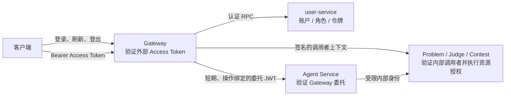

# 身份认证与业务授权设计

本文描述 OJ 平台当前的身份认证、可信身份传递和业务授权边界。这里的“认证”回答调用者是谁；“授权”回答该调用者能否对目标资源执行当前操作。Gateway 认证成功只建立可信调用者身份，不代表所有后端操作都已获准。

## 1. 设计目标与边界

- `user-service` 是用户账户、角色和外部访问令牌的权威服务。
- Gateway 是外部 HTTP/SSE 请求的认证入口，验证 Access Token，并构造后端可消费的可信身份上下文。
- Problem、Judge、Contest 等业务服务拥有各自的资源和授权规则，在业务服务内执行最终授权。
- 服务间调用使用受限的内部身份凭证；业务服务不接受客户端自行提交的身份 Header 或请求体字段作为认证依据。
- Agent 只能通过 Gateway 委托的身份访问业务服务；Prompt、模型输出和 Tool 描述都不是安全边界。



## 2. 外部身份认证流程

### 2.1 注册与登录

1. 客户端调用 Gateway 的注册或登录 REST API。Gateway 校验 HTTP/Proto 输入并将请求转给 `user-service`；它不读取用户数据库，也不校验密码。
2. `user-service` 负责用户名、邮箱规范化，账号查询和账户状态检查。密码使用 bcrypt 哈希保存；登录错误对外统一为无效凭据，避免泄露账号是否存在。
3. 登录成功后，`user-service` 签发 Access Token，并生成随机、高熵的 Refresh Token。当前默认 Access Token TTL 为 15 分钟、Refresh Token TTL 为 7 天。
4. Access Token 的 JWT claims 包括 `sub`（用户 ID）、`username`、`roles`、`iss`、`aud`、`iat`、`exp` 和 `jti`。Compose/生产部署配置使用 RS256：私钥只交给 `user-service`，Gateway 使用对应公钥及 `kid` 验签。本地默认配置仍保留 HMAC 兼容路径，便于旧部署迁移；新部署应使用 RS256。

### 2.2 受保护的外部请求

客户端以如下格式携带 Access Token：

```http
Authorization: Bearer <access_token>
```

Gateway 对受保护的 Operation 执行认证中间件：提取 Bearer Token，验证 JWT 签名算法、`kid`、签名、签发方、受众、有效期和主体 ID。缺失或无效 Token 返回 `UNAUTHENTICATED`。认证成功后 Gateway 从已验签 claims 构造 `RequestContext`，其中包含用户 ID 和角色，并附加由 Gateway 管理的 request ID 与 trace ID。

认证上下文仅从有效签名的令牌产生。请求参数、外部 Header、URL 中的用户 ID、客户端自报的角色都不能覆盖该身份。公开的注册、登录、刷新和登出 API 不要求 Access Token；其授权凭证分别是注册信息或 Refresh Token。

### 2.3 刷新与登出

Refresh Token 是不透明随机字符串，不是可解码的 JWT。Redis 只保存其 SHA-256 哈希对应的记录，并以 Session ID 关联同一登录会话下的令牌。

- 刷新时，服务端按哈希查询令牌，检查过期、撤销和重放锁定状态；成功后签发新 Access Token 和新 Refresh Token，并撤销旧 Refresh Token。
- 登出按 Refresh Token 找到所属 Session，撤销该 Session 下的 Refresh Token。未知、过期或已撤销令牌按幂等成功处理。
- 当前系统不维护 Access Token denylist。因此登出后，已签发的 Access Token 仍可用到其短 TTL 到期；客户端应清除本地令牌和用户状态。

## 3. 可信身份在服务间传递

Gateway 不把外部身份 Header 原样透传给业务服务。对于受保护的内部 gRPC 调用，Gateway 根据已经认证的请求上下文签发面向特定下游服务的内部 RS256 JWT。下游验证签名、issuer、audience、subject、有效期及目标 RPC 方法后，才把调用身份放入内部 `Principal`。

内部身份凭证表达两类信息：

- **调用服务身份**：例如 `gateway-service`，用于判断哪个服务在调用。
- **用户委托身份**：Actor ID、角色、request ID 和 trace ID，用于下游按当前用户执行资源授权。

Token 的 audience 限定到目标服务，RPC 方法字段限定到具体操作；配置了方法白名单的调用方还必须命中允许的方法集合。内部 Token 的有效期被限制在一分钟以内。下游服务间继续调用时，由当前服务按目标服务重新签发凭证，不沿用面向其他服务的 Token。

Agent Chat 与 Agent 管理 API 经 Gateway 认证后，Gateway 签发短期委托 JWT。委托声明绑定 Actor 身份与具体 HTTP 方法/路径操作；Agent 验证 Gateway 签名、issuer、audience、时间、调用操作和角色声明。Agent 访问业务数据时仍要调用相应 Go 服务，不能直接连接用户、题目、提交或比赛数据库。

## 4. 业务授权模型

当前系统使用角色检查和资源属性检查共同完成授权。角色提供较粗粒度的权限范围；资源所属服务结合资源所有者、比赛参与状态、资源状态和当前操作执行具体判断。

| 业务场景 | 授权依据 | 执行位置 |
| --- | --- | --- |
| 查询当前用户 | 已认证的用户 ID | `user-service` |
| 查询指定用户资料 | 用户本人或管理员角色 | `user-service` |
| 修改、归档题目及管理测试点 | 管理员角色；具体调用方限制也由服务校验 | `problem-service` |
| 查看提交、提交列表 | 提交所有者；管理员可按规则查看 | `judge-service` |
| 重新判题 | 管理员角色 | `judge-service` |
| 比赛管理 | 管理员角色及比赛状态规则 | `contest-service` |
| 比赛提交、排行榜和受限题目访问 | 用户身份、比赛参与关系、比赛生命周期和题目规则 | `contest-service` / 对应资源服务 |
| Agent 管理 API | 配置的管理角色及 Agent 管理开关 | Gateway 与 Agent 各自校验其边界 |
| Agent Tool 调用 | 当前运行允许的 Tool、用户身份/角色、参数及对应业务服务授权 | Agent Tool Registry 与业务服务 |

授权失败返回 `PERMISSION_DENIED`。不能把“已登录”或“拥有 admin 角色”解释成自动访问所有资源：资源状态、所有者关系和业务规则仍可能拒绝操作。对于 Agent，LLM 选择调用某个 Tool 也不授予权限；调用必须经过 Tool allowlist、角色/身份规则和业务服务自身授权。

## 5. 角色与授权数据的时效性

角色会作为 claims 写入 Access Token。Gateway 以及下游服务验证 Token 时不会为每个请求重新向 `user-service` 查询角色，因此角色变更通常要等现有 Access Token 过期或刷新后才反映到新令牌中。当前默认最长窗口由 Access Token TTL 限制；同样，禁用账户不会让已签发 Token 自动失效，除非资源服务另有即时状态检查。

当前设计以短期 Access Token 和业务服务最终授权控制风险，同时避免每个请求都依赖集中式身份查询。若未来要求角色或账户状态即时生效，应明确引入并验证相应机制，例如 Session/用户版本校验、短 TTL 配合主动刷新策略或可撤销 Token 状态表，并评估 Redis/数据库故障对请求可用性的影响。

## 6. 安全约束

- 私钥只部署到负责签发对应 Token 的服务；验证服务只需公钥。`kid` 用于选择受信任密钥，不允许 Token 自带密钥或指定外部密钥地址。
- 校验允许的签名算法、issuer、audience、subject、有效期和操作范围；签名正确但受众或操作不匹配的 Token 也必须拒绝。
- 对外统一认证和授权错误，不回显密码、Token、内部异常或其他凭据；日志不得记录密码、JWT、Refresh Token 和私钥。
- Refresh Token 在存储中只保存哈希；成功刷新轮换旧 Token，降低长期凭证重放风险。
- HTTP/gRPC 通道和内部网络仍需受部署网络策略保护。签名证明身份和声明完整性，不提供传输加密；跨不可信网络部署需使用 TLS/mTLS。
- 所有需要登录的 HTTP Operation 必须明确挂载认证中间件；新加业务 RPC 必须配置允许的内部 caller、audience 和方法范围，并在业务用例中补充资源授权。
- 安全测试应覆盖缺失/篡改/过期 Token、错误签名算法、未知 `kid`、issuer/audience 不匹配、错误 RPC/路径、Refresh Token 轮换重放、跨用户访问和无角色访问管理接口。

## 7. 当前边界与演进方向

1. **Access Token 即时撤销**：当前仅撤销 Refresh Token。若产品需要“改密/封禁/登出后立刻踢下线”，需要增加状态校验或 denylist，并定义缓存与依赖故障策略。
2. **角色快照**：长时间有效的授权声明会延迟反映角色变更。当前通过较短 Access Token TTL 控制窗口；更严格的系统可按安全级别选择实时授权查询或策略版本。
3. **内部调用范围**：每个 caller 应使用专用密钥/身份配置和最小 RPC allowlist，避免一个内部身份可以调用整个服务。密钥轮换应允许短期新旧公钥并存，再移除旧 key。
4. **传输安全**：JWT 不加密其 claims。不要放密码、秘密或不必要的个人数据；生产部署应保护私钥文件权限和服务间传输通道。

## 8. 代码与契约索引

- 外部令牌 claims、RS256 签名与验证：`pkg/auth/claims.go`、`pkg/auth/rs256.go`
- 用户密码、令牌签发和刷新用例：`services/user/internal/security/`、`services/user/internal/biz/usecase.go`
- Refresh Token Redis 存储：`services/user/internal/data/refresh_token_store.go`
- Gateway 外部认证：`services/gateway/internal/middleware/auth.go`
- Gateway 受保护 Operation 注册：`services/gateway/internal/server/http.go`
- 内部服务调用 Token 与 gRPC 拦截器：`pkg/internalauth/`
- Agent Gateway 委托：`services/gateway/internal/client/agent.go`
- Agent 委托验证：`agent/app/core/auth.py`
- User、Problem、Judge、Contest 资源授权：各服务 `internal/biz/` 与 `internal/service/`
- 外部 API 与错误契约：`api/gateway/v1/gateway.proto`、`api/user/v1/user.proto`、`api/common/v1/common.proto`
