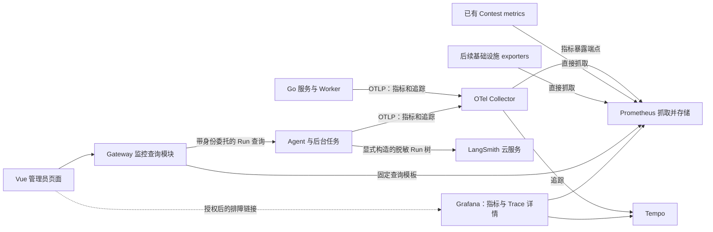

# Observability 模块设计草案

状态：基础本地观测栈、Issue #189 的 Agent Chat 本地追踪、Issue #191 的 Agent 后台任务本地追踪、Issue #200 PR1 同步 Judge Trace 与 PR2 异步 Judge Trace 已实现。判题运行指标和运行保障仍为后续阶段；本文中的设计项如未注明“已有”或“已实现”，均为规划。

已确认：使用 LangSmith 云服务；首期只上传脱敏元数据，不上传原始对话、源码或工具结果。

## 1. 目标与验收标准

管理员能回答三个问题：系统哪里异常、一次操作慢在哪里、Agent 的资源消耗与失败原因是什么。

首期交付一个端到端闭环，再扩展判题与基础设施：

1. `/admin/observability` 提供系统概览与 Agent 运行两个视图，默认最近 1 小时，每 15 秒刷新；展示数据时间、采集延迟、部分故障和无数据状态。
2. 一次聊天可以从 Gateway 追踪到 Agent、模型调用、Tool 和 Tool 下游 gRPC。管理员可用 `run_id` 找到脱敏运行详情、本地 Trace 以及已上传的 LangSmith Run。
3. 请求量、错误率、P95、Agent 运行状态、模型调用耗时、Token 和 Tool 错误有明确统计口径；没有采样到 Trace 时仍能查询业务 Run。
4. 普通用户不能访问监控 API；`agent_admin` 只能访问 Agent 运行视图，`admin` / `system_admin` 可访问系统视图。前后端分别执行权限检查。
5. Collector、Prometheus、Tempo 或 LangSmith 不可用时，聊天仍可完成、取消和保存终态；导出队列有界，观测故障自身可见。
6. 注入秘密标记的对话、源码、Prompt、工具返回和异常文本，导出载荷中均不得出现标记。

首期不包含自建 Trace 瀑布图、集中日志搜索、在线模型评审、完整告警管理、精确账单和自动扩容。

## 2. 现状与当前链路

### 2.1 文档与实现的差距

| 位置 | 已有能力 | 缺口 |
| --- | --- | --- |
| `docs/architecture.md` 第 14 节 | 规划 OTel / Prometheus / Grafana / Jaeger 或 Tempo | `deploy/compose/compose.yaml` 尚未部署这些组件 |
| `services/gateway/internal/middleware/auth.go` | 将 `X-Trace-ID` 放入 RequestContext | 字符串不是 W3C SpanContext，缺少标准分布式追踪 |
| `pkg/mq/envelope.go` | `trace_id`、`event_id`、`causation_id` | 缺少完整追踪上下文；Judge Outbox 构建消息时没有填入 TraceID |
| `services/contest/internal/server/metrics.go` | 独立端口的 Prometheus 文本及 JSON | 目前主要是排行榜缓存与 Outbox 计数，需接入统一采集 |
| `agent/app/models/provider.py` | ModelAttempt、ToolTraceStep、ModelSummary | 摘要不是时序监控；缺少统一 Trace、导出与管理员 Run 查询 |
| `agent/app/storage/schema.py` | Run 状态、时间、request_id、配置快照、model_summary、可空 trace_id | 管理员 Run 查询仍需受控接口与权限；`trace_id` 可为空以兼容历史 Run |
| `agent/app/graphs/model_runtime.py` | 使用 LangGraph；显式禁用 LangSmith 自动追踪 | 不能只改环境变量开启，否则可能上传 AgentState 中的内容 |
| `agent/app/evals/` 与前端 Eval 页面 | 数据集、程序检查、模型评审和人工评分 | 应复用现有质量工程，避免再建一套评测事实库 |

Go 服务已有 JSON 日志入口；Agent 也有 JSONFormatter，但统一的 `trace_id` / `span_id` 关联仍需补充。根 README 对 Agent 的能力描述落后于实际代码：规划以 Runtime、RAG、Eval、Memory 实现及对应设计文档为准。

### 2.2 聊天路径

```text
Vue → Gateway REST/SSE → Agent ChatController / RunService
    → ContextAssembler → ReAct 图 → ResponsesClient → Provider
                                 → ToolExecutor → 业务 gRPC / RAG / run_code
    → RunService 保存终态与摘要 → SSE done/error
    → 成功聊天触发 Memory Worker；Eval 有独立用途与运行管理
```

RunService 的完成标准是终态事务成功，不是模型结束、HTTP 200 或 SSE 连接建立。观测必须延续这一语义。

### 2.3 判题路径

```text
Gateway → Judge 提交事务（Submission + Outbox）
        → Outbox Relay → RabbitMQ → Worker / Sandbox
        → 结果事件 → Judge 终态及领域事件 → Contest 成绩与缓存投影
```

Worker 已测试 retry 保留 trace_id 与 causation_id，但仅有字符串不能恢复完整父 Span；追踪元数据必须随 Outbox 持久化，不能依赖 Relay 进程内 Context。

## 3. 推荐架构与职责



- **OpenTelemetry**：统一仪表、资源属性、传播和导出协议；它本身不提供历史指标存储与查询页面。
- **Collector**：批量、内存限制、有限重试、丢弃统计和统一路由。首期不把后端通用 Trace 转发到 LangSmith。
- **Prometheus**：统一指标查询来源。OTel 指标由 Collector 暴露供其抓取，已有 Contest metrics 保留原抓取方式。
- **Tempo + Grafana**：本地 Trace 存储与排障页面；首期仅选这一组，不同时部署 Jaeger。Grafana 提供详细查询，Vue 提供面向项目管理员的概览。
- **LangSmith**：Agent 的脱敏模型/工具 Run 树、版本筛选和人工排障；不是系统指标存储，也不是聊天成功与否的事实来源。
- **Gateway**：监控查询聚合、身份认证、系统视图授权和固定时序查询；不直接访问任何业务数据库，不提供任意 PromQL/URL 代理。
- **Agent**：拥有 Run 详情与管理员 Run 查询，并执行 Agent 管理员授权；现有 Eval 继续由 Agent 管理。

首期不新增独立 observability-service。观测后端增加在可选 Compose overlay 中，业务服务不以监控组件健康作为启动前提。日志先保留现有 JSON stdout/stderr，补关联字段；集中采集与 Loki 后续按需求引入。

## 4. 指标口径与数据边界

| 范围 | 优先指标 | 定义与注意事项 |
| --- | --- | --- |
| HTTP / gRPC | 请求数、延迟 histogram、错误数、在途数 | 标签使用路由模板或 RPC 名，拒绝原始 URL/资源 ID；P95 从合并后的 histogram 算，不能平均各实例 P95 |
| Agent Run | 开始数、终态数、在途数、持续时间、取消/超时 | 业务 Run 与 HTTP 请求分开；成功以 COMPLETED 事务提交为准；取消单列，展示错误率分母与样本数 |
| 模型调用 | attempt 数、重试、调用耗时、首个输出耗时、Token | 每次重试单独计数；区分 Provider usage 和保守估算，不把估算字节数展示为真实 Token 或账单 |
| 用户流体验 | 首段正文时间、完整运行时间 | 现有 first_token_ms 可能包含工具参数输出，不直接当作用户首段可见正文时间；新增独立测量 |
| Tool / RAG | 调用数、拒绝/依赖错误、耗时、空检索结果 | 区分校验拒绝和实际下游调用；不以 HTTP 200 代表工具成功；不采集检索文本和标题 |
| 判题 | 排队、编译、执行、完成延迟、verdict | WA/CE/TLE 等是正常判题结果，基础设施失败单列；重判 revision 与 attempt 进入 Trace，不作为指标标签 |
| 异步可靠性 | Outbox pending/dead、最老 pending 年龄、发布失败、重试、DLQ | 业务服务自己观测自己的 Outbox；队列积压与业务处理成功分别统计 |
| Contest | 缓存命中/回源/重建、投影积压及年龄 | 复用现有独立端口，并检查 observed_at，不能把旧 gauge 当作当前健康 |
| 后台任务 | RAG 索引、Eval、Memory 的队列/耗时/失败 | 通过任务执行上下文关联；chat、eval、review、memory、ingestion 用受控枚举隔离，尚未接入时显示无数据 |
| 进程和基础设施 | 进程 CPU/内存、连接池；后续容器/主机、MySQL、Redis、RabbitMQ、MinIO、Qdrant | 进程存活、服务就绪和业务可用分别展示；主机/容器指标需 exporter，不能从 OTel 请求埋点推断 |

所有业务指标独立于 Trace 采样记录。计数器是运维统计，进程崩溃、网络故障和导出丢弃可能造成缺口；历史 Run 以 Agent DB 为准，财务账单需另行对账。

指标标签采用显式允许列表：service、environment、规范化 route/RPC、status、受控 model/tool/error_code、purpose。模型名与错误码需要规范化和数量限制。不以 user_id、run_id、conversation_id、submission_id、请求文本、配置 UUID 为指标标签；这些 ID 仅按需出现在本地 Trace、Run 查询或受控日志中。

## 5. 追踪、LangSmith 与隐私

### 5.1 OpenTelemetry 传播

1. Go 新增 `pkg/observability/`，Python 新增 `agent/app/observability/`，统一生命周期、资源字段、采样、脱敏和导出；锁定 SDK、Collector 与语义约定版本。
2. 使用 W3C `traceparent` / `tracestate`。公网入口默认创建自己的 Trace；只有明确配置的可信上游才承接父上下文。无效上下文忽略，不影响业务；首期不传播任意 baggage。
3. 已接通 Gateway→Judge、Judge→Problem 的同步 gRPC 上下文注入/提取；Gateway HTTP 已使用 `otelhttp`。Judge 与 Problem gRPC Server 使用 `otelgrpc`，Judge 提交和重判入口创建业务 Span。RabbitMQ 与 Worker 的异步上下文仍由后续 PR 负责。
4. `RequestContext.trace_id` 改为当前 Span 的 trace_id 派生值；`X-Trace-ID` 兼容响应也由服务端生成。旧客户端传任意字符串不再决定 Trace 身份，需要同步更新现有 Gateway 契约测试。
5. 流式 Span 覆盖响应体消费与清理，而非只到响应头；记录业务终态，客户端取消及时关闭；HTTP 200 后的 SSE error 仍计入 Run 错误。
6. Tool→gRPC、内部 run_code、RAG、Eval、Memory 子任务分别关联执行上下文。不要把用户对话或凭据附到自动 HTTP、SQL、异常事件或 Span 名称中；默认关闭 SQL 语句与请求/响应正文采集。

### 5.2 Outbox 与 MQ

PR2 已在 Judge 的 outbox_events 增加可空 `traceparent` / `tracestate` 字段，将允许的追踪上下文与业务事件在同一事务保存。没有追踪上下文的历史行仍可发布。

Relay 从持久化上下文创建 publish Span，注入 AMQP Header 和 Envelope 字段；Worker、Judge 结果消费者、Contest 消费者提取并创建消费 Span，结果及后续 Outbox 继续保存因果上下文。单消息短任务采用父子关系；批处理、长延迟后台工作采用 Span Links，不伪造一直运行的 HTTP Span。

业务 `event_id`、`causation_id`、重试 attempt、ACK 和 publisher confirm 语义保持不变；每次投递/重投有独立 Span，不为了监控去重业务投递计数。缺少/畸形 Header 只会创建新 Trace，不能阻断或丢弃消息。新的可选字段与 Header 允许新旧消费者共存，先迁移、再生产者、再消费者，旧数据不回填虚构的父 Span。

### 5.3 LangSmith 元数据模式

保留现有图自动追踪关闭的保护。由专门适配器显式构造安全 Run 树，而不是给持有完整 AgentState 的函数直接加装饰器。根 Run 对应业务 Run，子 Run 对应每个模型 attempt、工具和检索阶段。实现应使用独立有界队列异步发送，配置 `AGENT_LANGSMITH_EXPORT_ENABLED` 默认关闭；云端请求失败不能改变业务终态。

允许上传的字段：随机 Run 标识、本地 otel_trace_id、环境、部署版本、配置版本 UUID、受控模型/工具名称、起止时间、Token 及 usage_source、枚举状态与稳定错误码。首期不上传用户 ID、会话标题、知识文档标题、完整配置快照和自由文本；确有后续会话分析需求时再设计随机关联标识。

inputs/outputs 置空，metadata 用字段允许列表构造；run name、tags、error、events、attachments、自动环境元数据也必须检查。原始对话、Prompt、源码、Tool 参数/正文、RAG 文本、隐藏推理、Authorization、Provider 错误原文和连接字符串不允许出现在任何导出通道。不要将现有 model_summary 原样上传，其中含知识标题和其他关联信息。

LangSmith SDK 与 OTel 共存及原生互通能力已有官方支持，但首期先用本地 trace_id / LangSmith run id 关联，避免自动双重导出及跨云全量扇出。对仓库锁定的 LangSmith 版本做 PoC，验证可用配置和真实载荷，不直接照抄最新版 API。后续需要统一导出时另行验证 Collector 过滤与 LangSmith 映射。

显式应用开关控制云导出；设置 LANGSMITH_TRACING 不得单独开启内容采集。适配器需隔离原始异常并限制网络调用及后台队列；RunTree 等手动 API 不受 tracing_context 开关约束，必须由适配器自己的开关统一约束。

## 6. 查询契约、页面与权限

以下是建议新增的只读接口，实施前按 `contract-change` 流程补齐 DTO/Proto、路由白名单和契约测试：

| 接口 | 所有者与来源 | 权限 |
| --- | --- | --- |
| `GET /api/v1/admin/observability/overview` | Gateway 查询固定的系统与采集健康指标 | admin、system_admin |
| `GET /api/v1/admin/observability/series` | Gateway 按 metric 枚举选择 PromQL 模板 | admin、system_admin |
| `GET /api/v1/admin/agent/observability/overview` | Gateway 验证 Agent 管理员角色，只查询专用 Agent 指标模板 | admin、system_admin、agent_admin |
| `GET /api/v1/admin/agent/runs` | Gateway 委托到 Agent；Agent 查询自己的 Run | admin、system_admin、agent_admin |
| `GET /api/v1/admin/agent/runs/{run_id}` | Agent 返回安全投影、关联 ID 和状态 | admin、system_admin、agent_admin |

Agent 指标概览由 Gateway 拥有，避免新增 Agent→Gateway 反向查询。Agent Run 查询继续使用已有 Gateway→Agent 委托协议，Agent 再次授权。

时序参数统一为 UTC `from/to/step`，支持最近 15 分钟、1 小时、24 小时，最长 7 天、每序列最多 1000 点，服务端限制 series 数、查询并发和 3 秒查询预算。错误率与分位数返回样本数；无样本为 null。概览附 `generated_at`、各数据源 `observed_at`、available/stale/unavailable 状态及稳定错误码；部分失败允许返回部分数据。5 秒内相同权限范围和查询的请求可合并，短缓存不引入 Redis 依赖。

Run 列表使用 `started_at DESC, id DESC` 稳定游标，默认 20 条、最多 100 条，强制时间窗，首期过滤 status / purpose / run_id；精确 model/version/skill 的复杂 JSON 筛选暂不开放。新增索引 `(started_at, id)`、`(status, started_at, id)`，purpose 通过 Agent 自有会话查询约束。监控查询预算和执行计划必须在真实 MySQL 验证。

Agent migration 新增可空 `agent_runs.trace_id`，在创建 Run 时固定；LangSmith 根 Run 使用同一个随机业务 Run UUID 作为逻辑关联标识。项目详情 URL 中的项目 UUID 同时作为 LangSmith 上传目标；Run 持久化导出状态和接受时的项目 UUID 快照，只有后台上传成功后 UI 才显示原目标链接。缺少密钥、队列已满或发送失败时不会显示可用链接；服务重启后未完成的内存队列标记为失败。

详情响应不得包含 messages、config_snapshot 原文或任意 model_summary JSON。明确映射模型 attempt、工具安全状态、运行时间和配置版本；链接由服务端基于受控部署地址构造，不能接受用户提供 URL。Grafana/LangSmith 详情使用各自独立认证，链接不是公开分享链接，页面不持有供应商密钥。

前端使用顶层“监控”工作区，与题库、提交、比赛、Agent 在顶栏并列。当前工作区包含 Agent 运行诊断和判题链路拓扑两个视图；系统指标总览与判题实时指标在后续接入后扩展。

- Agent 运行诊断：在途/成功/失败/取消、运行耗时、模型 attempt 与首段正文延迟、Token 来源、工具错误；下方 Run 列表与详情抽屉。该视图属于监控工作区，不属于 Agent 管理工作区。
- 判题链路：展示 Gateway、Judge Service、RabbitMQ、Judge Worker、Sandbox 和 Contest 结果回写的因果拓扑；队列积压、Worker 和 Sandbox 的实时指标在后续接入后显示。

图表允许区分没有流量、没有启用采集、采集故障；路由守卫只是用户体验，后端执行真实授权。轮询在页面不可见时暂停，旧查询取消，不重叠堆积；首期无需为监控新增 SSE。

## 7. 失败行为、采样与容量

| 场景 | 预期行为 |
| --- | --- |
| 监控组件启动失败或暂不可用 | 业务正常启动与处理；有界后台导出失败后丢弃并计数，不参与业务事务 |
| 终态保存失败 | 不记录业务成功；Span 可记录模型完成及保存失败，Run 保留现有恢复语义 |
| LangSmith 上传失败、限流或重复发送 | 不改变 Run 结果；同一逻辑 Run/attempt 使用稳定标识，有限重试；不承诺崩溃后补齐云 Trace |
| 进程重启 / Trace 被采样丢弃 | 持久 Run 仍可查询；CPU/inflight 等按实例解释；Trace 详情明确可能缺失 |
| MQ 重投、重判与乱序结果 | 投递 attempt 和最终业务状态分别计数，不改变现有幂等与版本保护 |
| 查询超时、局部数据源故障 | 短超时、部分结果、unknown/stale；不显示为 0 或绿色健康 |
| 非管理员、畸形筛选及越界查询 | 401/403 或稳定参数错误；拒绝任意 PromQL、资源 URL 和过大时间窗 |
| 多实例与并发运行 | 每实例有 instance id；histogram 正确聚合；Python 异步上下文不得串 Run |

开发与集成环境 Trace 默认 100%；生产先建议 10% 的根级一致采样，LangSmith 按逻辑 Run 使用独立一致采样。错误指标始终记录，错误 Run 可从数据库筛选；不承诺头部采样能保留全部错误 Trace。需要全部错误或慢 Trace 时再评估 tail sampling 的内存、路由和成本。

本地建议初始保留 Prometheus 7 天、Tempo 3 天，并设置实际存储容量与监控组件内存限制；这是开发起点，不代表生产容量承诺。首期测量开启前后的 CPU、内存、非流式 P95、首段正文延迟与 SSE 吞吐，再依据机器资源调整抓取周期、采样和留存。LangSmith 留存按实际工作区能力配置，实施时确认套餐与区域。

## 8. 实施顺序与每步验收

建立一个 Observability 父 Issue，按以下范围拆 PR；本文不创建 Issue 或修改生产代码。

| 阶段 | 实施内容 | 验收 |
| --- | --- | --- |
| Issue #200 PR1 同步 Judge Trace | Gateway→Judge→Problem gRPC Trace 传播；Judge/Problem provider 与 Server instrumentation；Judge 提交、重判 Span；可选 Compose OTLP 配置 | 同一 Trace 可跨 Gateway、Judge、Problem；未配置 Collector 使用 no-op；观测导出故障不改变业务语义 |
| Issue #200 PR2 异步 Judge Trace | Outbox trace context migration；AMQP Header/Envelope 传播；Relay、Worker、Judge Result、Contest Projection spans | 提交、重试、重判、重复事件、Relay 重启仍能关联因果路径，业务结果与 ACK/confirm 行为不变 |
| PR2 Agent 与 LangSmith | Run/模型 attempt/Tool、业务 gRPC 传播；trace_id migration；手动脱敏 LangSmith 适配器与显式开关 | 一次有工具的聊天可关联本地 Trace 与云 Run；Mock 上传载荷没有秘密标记；并发、取消、重试不串上下文。Issue #188 完成云导出基础；Issue #189 完成本地 Run Trace 与业务 Span |
| PR3 管理员最小页面 | Gateway 固定指标查询；Agent Run 列表/安全详情与索引；Vue 概览和运行 Tab | 管理员从异常指标进入 Run 详情并跳到排障页；普通用户与仅 Agent 管理员的越界请求被拒绝；失联显示 unknown |
| 后续 Judge/Contest 运行指标 | 队列、Worker/Sandbox、结果及排行榜投影指标；复用 Contest metrics | 判题排队、执行、失败和投影积压有稳定统计口径 |
| PR4 运行保障与扩展 | RAG/Eval/Memory worker 指标；基础设施指标、阈值告警、runbook、容量基线 | worker 堵塞、MQ 积压、Provider 限流和 exporter 丢弃能被发现并定位；告警可恢复 |

首个可交付里程碑为 Agent PR1–PR3，先打通“聊天→指标→管理员页面→运行详情→Trace/LangSmith”。Agent Chat Span 已在 Issue #189 实现；Memory、Eval/Review、RAG ingestion 的独立本地任务 Span 已在 Issue #191 实现；Issue #193 已补齐 Agent Run 安全查询、Gateway 契约、运行概览、受控 Trace 链接、分页和 Vue 运行诊断页。Issue #200 的同步与异步 Judge Trace 已分别在 PR1、PR2 接入；判题运行指标和基础设施 exporters 仍为后续工作。

## 9. 变更面与文档

- `pkg/observability/`、各 Go 服务启动与 HTTP/gRPC client/server：共用遥测配置、上下文和日志关联。
- `agent/app/observability/`、main/settings、RunService、模型/工具调用与后台任务：统一上下文、业务埋点和安全云导出。
- `deploy/compose/`：新增监控 overlay、固定版本配置、Grafana provisioning；更新 Makefile 和 `.env.example` 的非秘密配置说明。
- `services/gateway/`、必要的 `api/gateway/v1/`、Agent operations、管理 API 和 Gateway 响应校验白名单：新增受控查询契约。生成文件由工具生成。
- `migrations/agent/`：Run trace_id 与查询索引；`migrations/submission/`：Outbox 上下文字段。迁移编号以实施时的最新仓库为准，先加可空字段兼容旧服务；不得清空已有数据。
- `web/src/observability/`、views、router 和导航：监控 DTO、查询、可视化、权限和异常显示；只读查询使用现有认证客户端。
- 不新增业务 Redis key 或 MinIO 对象；观测历史归 Prometheus/Tempo/LangSmith，业务 Run 和事件仍归原服务。
- 更新 `docs/architecture.md`、`docs/requirements.md`、`docs/api.md`、`docs/database.md`、部署说明与 Agent README；根 README 同步实际 Agent 能力与观测进度。新增运行手册说明留存、采样、云导出内容、故障排查与停用方式。

## 10. 验证策略

1. 单元：标签规范化与数量限制、时间窗/step、错误率分母、空数据、脱敏 DTO、显式开关、稳定 Run/attempt 标识及上下文隔离。
2. 集成：内存 exporter / Mock LangSmith 检查实际导出载荷；MySQL migration 与 Run 查询分页；Collector→Prometheus/Tempo；覆盖 SSE 完成、断连取消、Provider 失败和终态提交失败。
3. 契约与负向：Gateway/Agent 路由白名单及响应白名单、401/403、agent_admin 系统数据隔离；W3C Header、旧 MQ 无 Header、畸形 Header、新旧服务混合、Outbox 重启传播。
4. 异步回归：保留 publisher confirm、失败不提前 ACK、幂等与重判/投影版本语义；遥测失败不改变业务分支。
5. 前端 E2E：时间窗、轮询暂停、正常/失败/无流量/无采集/部分故障、分页与详情、链接需要独立登录。
6. 性能与故障注入：采集停机、LangSmith 超时/429、导出队列满、多实例与并发 Run；测量额外延迟和内存是否有界。

现有检查以 Makefile 和 web/package.json 为准：Go fmt/vet/test/build、Agent check/unit/integration、Web test/build 与相关 Playwright。`make agent-eval` 当前仍是占位，不能作为已完成评测的证明；涉及 Runtime 时使用现有 Eval Runner/集成用例做行为回归。新增监控集成检查需明确脚本入口并接入 CI。

现有 `agent/tests/test_model.py`、`agent/tests/test_runtime.py` 中“外部追踪默认关闭”的测试继续保留；新增显式安全导出路径的测试，不能通过删除隐私保护断言实现接入。

每个新增功能 PR 按项目规范完成独立只读审查；PR4 同时应用 async-reliability-review。规划阶段没有运行应用或测试，上述是实施验收要求。

## 11. 实施前剩余确认

这些不阻止最小链路开发，但会影响生产配置：

- 生产机器资源、实例数量、流量和存储预算：决定采样、retention、exporter 与监控是否独立部署。
- LangSmith 工作区、区域、套餐权限与保留期限：决定云端配置、链接和费用上限；密钥只通过部署 Secret 注入。
- 后续告警接收渠道与值班方式：先定义规则与面板，实际外发通知单独配置。

## 12. 上游参考

- [OpenTelemetry Signals](https://opentelemetry.io/docs/concepts/signals/)
- [LangSmith 输入、输出和元数据脱敏](https://docs.langchain.com/langsmith/mask-inputs-outputs)
- [LangSmith 手动追踪与运行 ID](https://docs.langchain.com/langsmith/annotate-code)
- [LangSmith 与 OpenTelemetry 互通](https://docs.langchain.com/langsmith/trace-with-opentelemetry)

上游文档于 2026-10-21 查阅；实施时需再次对照仓库锁定的 SDK 版本验证。
