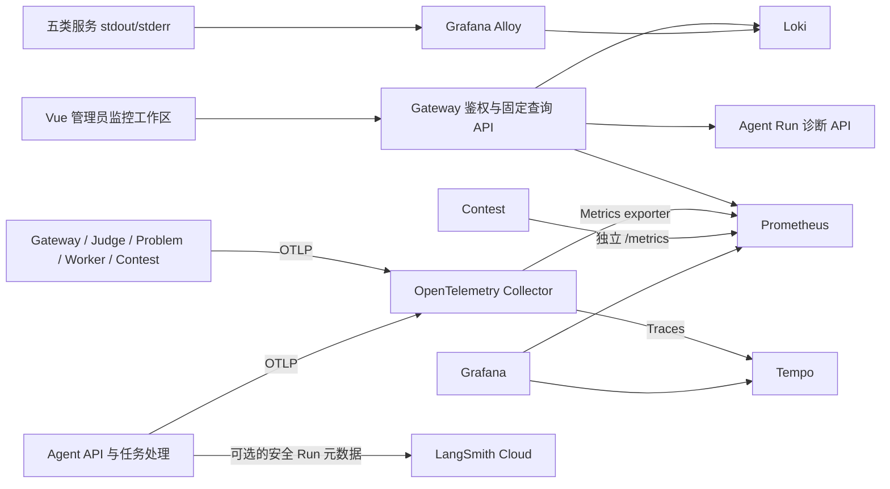

# Observability 系统设计

## 目标与边界

Observability 为 OJ 业务提供指标、分布式追踪、结构化日志与管理员诊断入口。它是业务旁路：Collector、Prometheus、Tempo、Loki 或 LangSmith 不可用时，不改变提交、判题、消息确认、Agent Run 终态或后台任务状态。业务事实仍以所属服务的数据为准；观测数据用于定位问题，不是账务或审计记录。

默认业务 Compose 不启动观测后端。需要本地观测环境时，通过 Compose observability overlay 启动；未配置 OTLP endpoint 的 Go 和 Agent 进程使用无导出行为。当前服务拓扑和采集链路如下：

## 信号与服务职责

### 指标

Go 服务和 Agent 使用 OpenTelemetry Metrics；Contest 同时保留独立的 Prometheus `/metrics` 端点。Collector 暴露 OTel Metrics exporter，由 Prometheus 抓取；Prometheus 每 15 秒抓取 Collector exporter、自身遥测端点和 Contest。数据默认保留 7 天。固定 Metrics 字典、属性 allowlist、单位与计数语义见 [Metrics 指标字典](metrics.md)。

已采集的业务指标覆盖 HTTP/gRPC 延迟和请求状态、Judge 提交/排队/编译/执行、Worker/Outbox/结果消息、Contest 投影和缓存 Outbox，以及 Agent Run、模型、Tool、RAG 和后台任务。仪表不以业务 ID、Trace ID、用户输入或任意错误文本作为标签。基础设施 exporter 尚未接入，因此 MySQL、Redis、RabbitMQ、MinIO、Qdrant 和主机资源的健康/容量不由当前指标覆盖。

Prometheus 告警规则当前包括抓取目标异常、持续判题积压、Contest Cache Outbox 陈旧积压和 Agent 模型错误率。没有 Alertmanager 或外发通知配置；告警只在 Prometheus/Grafana 和监控首页可见。

### 追踪

Go 与 Python 服务通过 W3C Trace Context 传播 Trace。Gateway 对公网请求建立自己的根上下文，不接受客户端传入的 `traceparent` 作为可信根。同步链路覆盖 Gateway → Judge → Problem；Judge Outbox 将 Trace Context 持久化到事件并通过 RabbitMQ 传播，Worker、Judge 结果处理、Contest 投影和 Contest Cache Outbox 继续创建关联 Span。Agent Chat Trace 覆盖 Run、模型 attempt、Tool、RAG 和业务 gRPC；Memory、Eval/Review 与 RAG ingestion 后台任务各自建立任务 Trace。

Trace 发往 Tempo，Grafana 提供 Tempo Explore。Judge 管理员入口基于受控的 submission 属性生成固定查询链接；链接可用不表示一定存在采样数据。Agent Run 诊断详情会显示可用的 Tempo 链接。Trace 与业务存储的保留、采样和可用性相互独立。

### 日志

Gateway、Judge、Judge Worker、Contest、Agent 的 JSON stdout/stderr 由 Alloy 从 Docker API 读取并写入 Loki。日志的 `trace_id`/`span_id` 来自当前 OTel 上下文；Trace ID、业务 ID 和错误码保留为日志结构化字段，不作为 Loki 索引标签。索引只使用服务、环境和级别等低基数维度。日志采集、轮转、保留和查询边界见 [Loki 日志架构与运行约束](loki.md)。

Problem Service 和 RAG Worker 当前不在 Alloy 的 Docker service allowlist 中；虽然日志查询接口的服务目录包含这些名称，但该配置不会为它们产生 Loki 日志。需区分“查询目录支持”与“采集器已接入”。

### Agent 云端运行数据

Agent 可按部署配置将安全投影后的 Run/模型/Tool/RAG 元数据异步发送到 LangSmith。云端导出默认关闭，由显式应用开关启用，队列有界，失败不影响本地 Run 终态。inputs/outputs 为空；原始对话、Prompt、源码、工具参数/结果、RAG 正文和凭据不进入该导出。LangSmith 是 Agent 调试的可选副本，不是本地 Trace、指标或 Run 事实来源。

## 管理界面与查询接口

Vue 顶栏的“监控”工作区包含系统总览、固定 Metrics、Agent 运行诊断、Judge 链路和日志中心。Grafana 保留为本地开发/运维工具，不作为正式业务总览界面。页面状态区分有数据、无数据、未配置、部分接入、过期和上游不可用，不把空数据当成健康或零值。

| 接口 | 数据来源与用途 | 访问范围 |
| --- | --- | --- |
| `GET /api/v1/admin/observability/metrics?window=15m\|1h\|24h` | Gateway 对 Prometheus 执行固定查询并返回安全序列、时间戳和抓取目标 | 平台管理员可查系统；`agent_admin` 仅查 Agent 范围 |
| `GET /api/v1/admin/observability/services` | 固定服务清单与后端健康探测 | 平台管理员查系统；`agent_admin` 查 Agent/RAG 条目 |
| `GET /api/v1/admin/observability/alerts` | Prometheus 当前活动告警的字段 allowlist 投影 | 平台管理员查系统；`agent_admin` 仅查 Agent 模型错误率 |
| `GET /api/v1/admin/observability/judge/submissions/{submission_id}` | 通过 Judge 校验资源后生成固定 Tempo 搜索链接 | `admin`、`system_admin` |
| `GET /api/v1/admin/observability/logs` | Gateway 使用固定 LogQL 模板查询 Loki | 平台管理员查系统；`agent_admin` 仅查 Agent 服务范围 |
| `GET /api/v1/admin/agent/observability/runs` 和 `/runs/{run_id}` | Gateway 委托 Agent，返回 Run 安全摘要与详情 | `admin`、`system_admin`、`agent_admin` |

所有观测查询由后端鉴权、检查角色范围并限制上游地址、查询表达式、时间窗和响应大小。前端路由保护只改善交互，不构成授权。普通用户不能访问管理员监控 API。接口完整参数与 JSON DTO 见 [`docs/api.md`](../api.md)。

## 可靠性、安全与容量

- OTel 导出、Prometheus、Trace、日志查询和 LangSmith 上传均为旁路依赖；观测故障不应阻塞业务请求或异步消息处理。
- Metrics label 和 Loki label 使用低基数 allowlist。用户、Run、提交等标识只在有权限控制的 Trace 或结构化日志字段中用于关联；原始正文和凭据不进入观测数据。
- Gateway 固定后端查询不接受客户端传入 PromQL、LogQL、Loki/Prometheus 地址或任意 Grafana 跳转地址。
- 监控 API 将 TCP 探测、Agent readiness、Prometheus scrape 状态和业务健康分别呈现。TCP 可连通不代表依赖已就绪；`no_data` 也不代表零请求或健康。
- Loki retention 与 Prometheus retention 都不是硬磁盘配额。当前本地 Compose 使用命名卷；容量和磁盘告警需在部署主机另行设置。
- 观测 Compose 端口绑定 loopback；Grafana 使用匿名 Viewer，Docker socket 供 Alloy 读取容器日志。这是受控开发环境配置，不适合作为共享或生产环境的安全边界。

## 当前限制

- Alertmanager、通知渠道和基础设施 exporters 尚未配置。
- 服务探测不是全覆盖健康探测；部分服务仅检查 TCP，RAG Worker 没有独立探针。
- 日志查询最多覆盖 24 小时、返回最多 200 条，没有游标分页或实时 tail；Problem Service 与 RAG Worker 尚未被 Alloy 收集。
- Judge 入口用 submission 属性搜索 Tempo，不返回预先解析的 Trace ID；链接可用与 Trace 实际存在是不同状态。
- 本地日志、指标、Trace 有各自保留窗口，且日志/Trace 查询不是业务记录的完整替代。
- Loki 7 天 retention 和 Docker `json-file` 轮转已配置；没有独立磁盘 quota，也未以加速时间模拟验证 retention 到期后的物理删除。

## 本地运行

从仓库根目录执行 `make observability-up` 启动观测 overlay，执行 `make observability-down` 停止观测组件。`make observability-check` 校验 Compose、Collector、Prometheus、Loki 与 Alloy 配置；`make observability-smoke` 检查已启动栈；`make loki-smoke` 执行隔离的 Docker → Alloy → Loki 采集、Trace 检索和 Alloy 重启验证。具体地址、环境变量和日志运维注意事项见 [部署说明](../../deploy/compose/README.md) 与 [Loki 运维文档](loki.md)。
