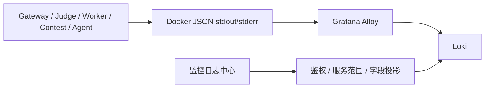

# Loki 日志架构与运行约束

## 采集链路

业务服务将 JSON 日志写入 stdout/stderr，Docker `json-file` 驱动保存并轮转，Grafana Alloy 从 Docker API 读取日志并写入 Loki。Gateway 日志 API 使用固定查询模板访问 Loki；浏览器不直连 Loki，也不提交任意 LogQL。



Alloy 当前仅采集 Docker Compose service `gateway-service`、`judge-service`、`judge-worker`、`contest-service` 和 `agent-service`。Problem Service 与独立 RAG Worker 不在 Alloy service allowlist 中。Gateway 的服务目录允许查询 `problem-service` 与 `agent-rag-worker` 名称，但没有采集端来源时查询只会返回无数据。

## 日志结构与索引

Go 服务使用共享 JSON `slog` handler；Agent 使用 JSON formatter。可用字段包括 UTC `timestamp`、`level`、固定 `service_name`、`message`，以及当前 Span 可用时的 `trace_id`、`span_id`。业务日志按服务输出已登记的 `error_code` 和必要业务关联字段。Agent formatter 只输出 allowlist 中的 `error_code`、`error_type`、`run_id` 和 `request_id`。

Alloy 仅接受 JSON 日志，格式错误的行由 `drop_malformed` 丢弃。Loki 的低基数 labels 为 `service_name`、`environment` 和 `level`；Trace ID、Run ID、submission ID 和其他业务标识是日志内容字段，不是索引 label。LogQL 使用 JSON parser 提取字段后执行 Trace ID、错误码和业务筛选。

Go logger 会丢弃常见正文、凭据和错误对象字段；Agent logger 不序列化异常栈或未登记的额外字段。Gateway 对返回消息执行凭据模式脱敏、控制字符清理和长度限制。源端日志仍需遵守不写入源码、Prompt、模型/Tool/RAG 正文和凭据的约束；Gateway 脱敏不能清理任意敏感正文。

## 访问与查询

日志中心位于 Vue“监控”工作区。Gateway 使用服务端 `OBSERVABILITY_LOKI_URL` 和固定 LogQL 模板查询，设置 `Cache-Control: no-store`，并限制请求超时与上游响应大小。

`GET /api/v1/admin/observability/logs` 支持以下参数：

| 参数 | 当前限制 |
| --- | --- |
| `service` | 固定服务目录；`agent_admin` 限于 Agent 服务范围 |
| `level` | `DEBUG`、`INFO`、`WARN`、`ERROR` |
| `error_code` | Gateway 固定错误码目录 |
| `trace_id` | 32 位小写十六进制 Trace ID |
| `start`、`end` | RFC3339 时间；默认最近 15 分钟，范围最长 24 小时 |
| `limit` | 默认 100，范围 1–200 |

查询不接受任意 LogQL、Loki URL、label selector 或额外参数。响应仅包含时间、级别、服务名、消息、允许的错误码/Trace ID/Span ID 和业务关联 ID，不透传 Loki stream labels、内部地址或未知字段。状态区分 `available`、`no_data`、`not_configured` 与 `unavailable`。

平台角色 `admin`、`system_admin` 可查询系统服务；`agent_admin` 只能查询 Agent 服务范围；普通用户不能访问监控日志 API。`/api/v1/admin/observability/logs/link` 接受 Trace ID 并复用相同受控查询与授权，不返回 Loki/Grafana 跳转 URL。

当前没有游标分页或实时 tail。单次查询最大 200 条，最大时间范围 24 小时；需要更早或更多记录时应缩小时间范围或使用受控运维查询工具。

## 保留、轮转与存储

| 配置 | 默认值 | 当前作用 |
| --- | --- | --- |
| `LOKI_RETENTION_PERIOD` | `168h` | Loki 逻辑保留期，即 7 天 |
| `DOCKER_LOG_MAX_SIZE` | `10m` | 每个容器单个 Docker 日志文件最大大小 |
| `DOCKER_LOG_MAX_FILE` | `3` | 每个容器保留的 Docker 日志文件数 |
| Alloy storage volume | 命名卷 | 保存 Docker 日志读取位置 |
| Loki storage volume | 命名卷 | 保存 Loki WAL、索引和日志块 |

Loki compactor 每 10 分钟检查 retention；到期删除为异步操作，不保证精确到某一时刻完成。Retention 不是磁盘硬配额：本地命名卷没有固定容量上限，生产部署需要为 Loki 数据目录设置磁盘/卷配额并监控磁盘使用和写入失败。磁盘满时 Loki `/ready` 仍可能正常，因此 ready 状态不能替代容量告警。

Alloy 的读取位置不是 Loki 写入确认；异常窗口可能产生重复或丢失，当前不承诺 exactly-once。Docker 轮转窗口耗尽后，Alloy 停机期间未读取的旧日志不可恢复。调整 Docker log 配置需重建业务容器，单纯 restart 不会更改 logging driver 选项。

## 安全与部署限制

本地观测 overlay 将 Loki、Alloy 管理端、Prometheus、Tempo、Collector health 和 Grafana 端口绑定到 loopback。Grafana 使用匿名 Viewer，适用于受控开发机。Alloy 通过 Docker socket 读取宿主机容器；`/var/run/docker.sock:ro` 不会限制 Docker API 的操作权限。共享/生产部署应使用权限受限的主机采集器或经审查的 Docker API 代理，并在网络层和认证层保护 Loki、Grafana、Prometheus 与 Collector。

## 本地检查

```bash
make observability-up
make observability-check
make observability-smoke
make loki-smoke
make observability-down
```

`make observability-check` 校验 Compose、Loki 和 Alloy 配置；`make observability-smoke` 检查已启动的观测栈。`make loki-smoke` 在随机隔离的 Docker Compose 项目中，以五类服务日志验证采集、Trace ID 查询、非法 JSON 丢弃与 Alloy 重启读取位置；结束时清理自己的临时资源，不触碰业务 Compose 项目。上述检查不模拟 Loki 7 天 retention 到期后的物理清理或磁盘满场景。

整体数据流、权限范围与 Metrics/Trace 关系见 [Observability 系统设计](design.md)；API 参数与响应状态见 [`docs/api.md`](../api.md)。
