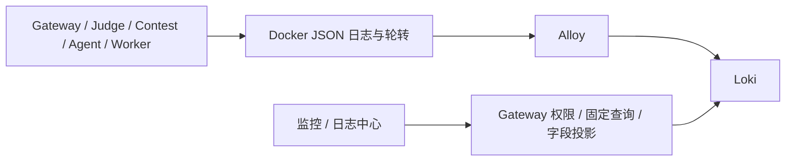

# Loki 日志运行手册

日志由业务进程写到 Docker stdout/stderr，Alloy 从 Docker API 读取，经 JSON 解析后写入 Loki；Vue 日志中心只调用 Gateway 受控 API。Metrics 继续使用 Prometheus，Trace 继续使用 Tempo。日志后端故障不影响提交、判题、ACK 或 Agent Run 终态。

## 配置与生命周期

在项目根目录执行 `make observability-up` 启动可选 overlay，`make observability-down` 停止采集与查询组件。停止不会删除 Loki/Alloy 卷；不要在日常排障中执行 `down -v`。修改轮转配置后需重建目标容器，单纯 restart 不会更换 Docker logging 配置。

| 参数 | 默认值 | 含义 |
| --- | --- | --- |
| LOKI_RETENTION_PERIOD | 168h | Loki 日志保留期，至少 24h |
| DOCKER_LOG_MAX_SIZE | 10m | 每个容器单个日志文件大小 |
| DOCKER_LOG_MAX_FILE | 3 | 每个容器保留文件数 |
| OBSERVABILITY_LOKI_URL | overlay 内 http://loki:3100 | Gateway 服务端查询源 |

Loki Compactor 每 10 分钟检查保留期，删除有异步延迟。保留期不是磁盘硬配额：开发环境命名卷没有可移植的大小限制，生产部署必须为 Loki 数据目录配置独立卷/文件系统配额并监控磁盘用量。容量估算按实测压缩后字节/秒 × 保留秒数，再为 WAL、索引、Compactor 和故障积压留余量；不能用摄取速率上限代替存储限额。磁盘满时写入失败，`/ready` 仍可能成功，必须检查写入失败和磁盘使用量。

Alloy 数据卷保存读取位置；正常重启应从读取位置继续。读取位置不等于 Loki 持久确认，故障窗口可能出现重复或丢失，不承诺 exactly-once。Docker 默认每容器约 30 MiB 的轮转窗口耗尽后，停机期间尚未读取的数据无法恢复。应先按日志速率和允许的采集停机时长计算轮转窗口，再配置大小/数量。

## 字段与权限

基础字段为 timestamp（UTC）、level、service_name、message；有 OTel 上下文时附加 trace_id/span_id。业务标识 run_id、submission_id、event_id 仅作结构化字段。Loki 索引 labels 限制为低基数服务、环境、级别，Trace/业务 ID 不得作为索引标签。源日志不得记录源码、Prompt、模型/Tool/RAG 正文和凭据；Gateway 字段投影与消息脱敏是第二道过滤，无法修复源端已写入的任意敏感正文。

平台管理员可查系统范围；agent_admin 仅能查询 Agent 范围；普通用户不能进入监控。Loki/Alloy 开发端口只绑定 loopback，没有直接提供用户鉴权。Docker socket 的只读挂载不等于 Docker API 只读权限；该栈用于受控开发机，共享部署需要专用主机采集器或受限 Docker API 代理。Grafana 暂留作排障工具，不是产品日志界面。

## 查询与排障

在监控侧栏进入日志中心。先选服务、最近时间，再按级别/稳定错误码缩小范围；Agent Run 详情可带入 Trace ID。Judge 当前只提供按 submission 属性检索 Tempo 的链接，没有返回具体 Trace ID，因此需从 Tempo 确认 Trace ID 后在日志中心输入，不能把 submission ID 当作 Trace ID。

- `not_configured`：检查 Gateway 的 OBSERVABILITY_LOKI_URL 和 overlay 是否加载。
- `unavailable`：检查 Loki `/ready`、Gateway 到 Loki 的网络、写入/查询错误和请求超时。
- `no_data`：检查所选服务/时间范围、容器是否产生 JSON 日志、Alloy targets 和 JSON 丢弃计数；不代表业务健康。
- Trace 搜不到：确认 Trace ID、时间范围、采样和 Loki/Tempo 各自保留期。日志可能存在但 Trace 已过期，反之亦然。

查询 API 最多 24h、200 行、1 MiB；当前没有完整游标分页或实时 tail，达到上限时缩小时间范围。错误码以 Gateway 登记目录为准，不接受任意 LogQL/上游 URL。

## 验证

`make observability-check` 校验 Compose、Loki 配置和 Alloy 配置；`make observability-smoke` 检查运行中组件；设置 OBSERVABILITY_SMOKE_REQUIRE_LOGS=true 后要求五个目标服务最近 15 分钟确有日志。

`python3 scripts/loki_smoke.py` 启动隔离的临时项目，使用五个带服务标签的 JSON 日志容器，通过真实 Docker → Alloy → Loki 按 Trace 检索，再重启 Alloy 检查重放。结束时仅删除该随机项目和它的卷，不操作业务栈。CI 运行该检查。它证明采集、关联和正常重启，不模拟 7 天后的物理删除或磁盘满；后两项需在专用容量环境验证。
